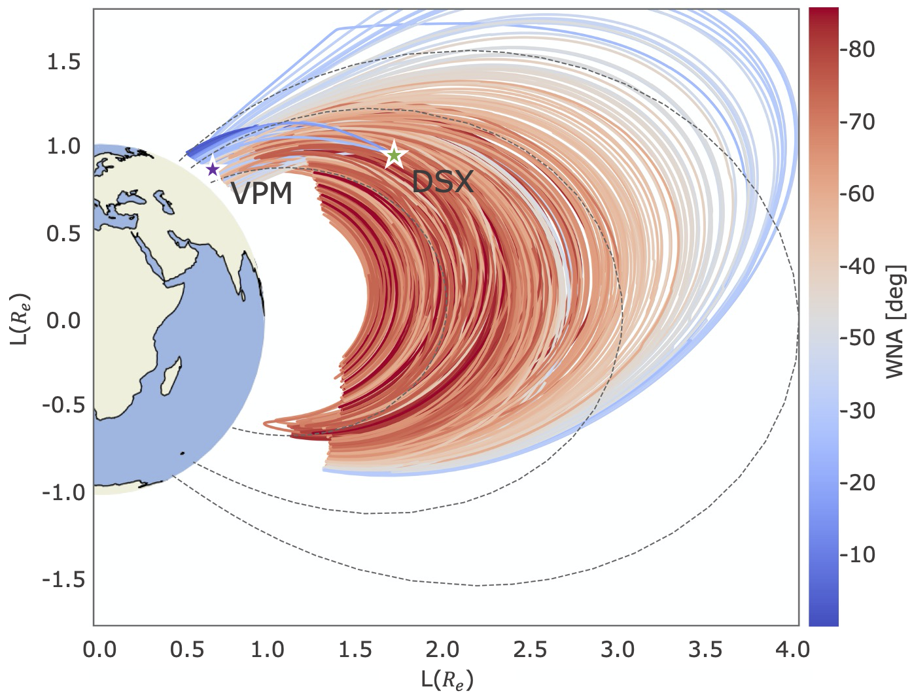

# Stanford_Raytracer

Welcome to the Stanford Raytracer. This ray tracing program computes VLF ray paths in the magnetosphere.
This ray tracer has been moved to run on CU's supercomputer (Blanca and Summit -- see more info [here](https://curc.readthedocs.io/en/latest/index.html)).

I would strongly recommend following the instructions below to running this on the supercomputer. 
If you need to make changes to the source code (Fortran) then follow the instructions at the very end to
install this repo on your local machine and modify it. 

## First a quick tour of the folders in here 
- bin - executables (the docker image pulls the ./raytracer from here)
- fortran - all fortran source code (raytracer, plasmasphere model adapters, etc.)
- gcpm - GCPM (a plasmasphere model, the simplification to create mode 6 occurs in fortran source code)
- iri2007 - IRI (an ionosphere model, required by GCPM)
- lapack-3.2.1 - Lapack and BLAS, used for solving Ax=b
- matlab - a raytracer written in matlab. I think it works, but I've never used it...
- tricubic-for - Tricubic interpolator
- tsyganenko - Tsyganenko magnetosphere model
- xform - coordinate transformation tools (single precision)
- xform_double - coordinate transformation tools (double precision), this is also used inside of python_setup for coordinate transforms with a python wrapper... might be redudant but oh well

and the files:

- Makefile - this runs the make command to build the raytracer
- Dockerfile - buils the raytracer into an image
- .dockerignore, .gitignore, .gitmodules - docker and git specific files to keep it nice
- default_config.json - an example of a raytracer input file
- default_config_description.md - a description of every single parameter in more detail than you likely want for the config.json file
- exmaple_blanca_run.sh - an example job script to run on blanca nodes
- exmaple_summit_run.sh - an example job script to run on summit nodes
- run.sh - a bash script to fun the raytracer using Docker, on your local machine

## Getting your rays ready to run

If you don't already have a supercomputing account, skip to step 3 to start that process, it can take a while. Then come back to step 1 while you wait for your account to be activated. 

1. *Create config file:* Let's start with the config file. It's easier to create this on your local machine and then copy it over. First, wherever you like to work on code, make a file called config.json. This will have all the settings for your raytracer run. 

    There is a [default_config.json](https://github.com/rareid2/Stanford_Raytracer/blob/master/examples/default_config.json) in this repo that you can copy from and re-work as you like. You can copy over the default settings in the top of the file, and then edit the rays section. *Make sure to change the output directory to include your summit username*. Details on these settings can be found here: [default_config_description.md](https://github.com/rareid2/Stanford_Raytracer/blob/master/examples/default_config_description.md)

    If you're running lots of rays, I'd reccommend generating this section with your language of choice. To generate the rays section from python, see [here](https://www.kite.com/python/answers/how-to-dump-a-dictionary-to-a-json-file-in-python). I also have some code that does this in [this repo](https://github.com/rareid2/dsxvpm_analysis). For matlab, see [here](https://www.mathworks.com/help/matlab/ref/jsonencode.html). I chose json format because it's compatible with a lot of languages and easy to edit from a text editor (and bc a software developer told me too).

    Once you are happy with the config file, move on to the job script file. 

2. *Create job script:* If you're running on blanca, take a look at [example_blanca_run.sh](https://github.com/rareid2/Stanford_Raytracer/blob/master/examples/example_blanca_run.sh) and for summit take a look at [example_summit_run.sh](https://github.com/rareid2/Stanford_Raytracer/blob/master/examples/example_summit_run.sh).

    Make any edits you see fit (name, date, title of run). Finally, make sure your config file is titled 'config.json'. If it's not, you're going to need to change the run command to the correct name of the config file and path. This run script assumes you're going to put it in the projects directory, so let's do that next. 

## Getting the raytracer on summit
3. *Get an account:* You need an account. Follow the instructions [here](https://rcamp.rc.colorado.edu/accounts/account-request/create/organization) to get one.

4. *File transfer:* Next, move the run script and config file to supercomputer. 

    Run this command from terminal to move it (you'll need log in info) `scp <path_to_config> <path_to_job_script> <username>@login.rc.colorado.edu:/projects/<username>/` 

5. *Log in:* Now, actually log in to the supercomputer:

    `ssh <username>@login.rc.colorado.edu`

    Learn a little about the file structure [here](https://curc.readthedocs.io/en/latest/compute/filesystems.html). You have a home directory, projects directory, and a scratch directory. I'd reccommend installing the raytracer image into the projects directory and keeping your job scripts and config files in here too.

    Make sure the files are where they are supposed to be: 

    `cd /projects/<username>/`

    `ls` 

    If you see a config file here and a job script you're good to go!

6. *Load needed modules:* We now need to pull the latest image of the raytracer into summit. We have to do this from a compile node, so go ahead and run: 

    `ssh scompile`

    Note that when you run this, it will take you right back to your home directory. Let's move over to projects again:

    `cd /projects/<username>/` 

    Now let's get singularity module loaded (a containerization software supported by summit - more information [here](https://curc.readthedocs.io/en/latest/software/ContainerizationonSummit.html?highlight=singularity#singularity)):

    `module load singularity/3.6.4`

7. *Pull latest image:* And finally, let's get the image (this might take a sec, it's about 1GB):

    `singularity pull docker://rareid/raytracer:latest`

    If you've got a lot of images, or you re-ran this command a lot, you may encounter an error that says you don't have enough space for this image. If that happens, try to purge your singularity cache:

    `singularity cache clean` 

8. *Submit job:* That's everything we need! Let's submit the job. 

    Type `cntrl+d` to exit out of the compile node. 

    If you're running on blanca, you need to load that module real quick: 

    `module load slurm/blanca` 

    Now, run `sbatch <jobfile.sh>` to submit your job.

    And you're done! Terminal output (ray exit code, etc.) will be in the `REPORT` file when the job finishes, in your project directory. The actual ray output will be in a folder created where you specificed in the config file (likely in your project directory as well). For some fun plotting tools, and output file parsing, check out this repo [here](https://github.com/rareid2/SR_interface).

    To get your files off the supercomputer, (`scpr -r` copies an entire directory) run on your local computer: `scp -r <username>@login.rc.colorado.edu:/projects/<username>/<rayoutput> <path_local>`

## Building the raytracer locally

The ray tracer uses an old version of gfortran to compile some pretty old code (fortran 77!). As everyone's computers are continuously updating, this version of gfortran is quickly becomeing out of date. That's why we use Docker to effectively "freeze" and run the raytracer with the needed compiler. A great future project would be updating the source code to be compatible with new compilers (or newer software languages...). 

But for now, here's how to buid the docker image and run the raytracter locally:

### Installs:

1. *Docker:* Download and install Docker Desktop for your machine [here](https://www.docker.com/products/docker-desktop/)

2. Sign up for a dockerhub account, especially if you intend to make changes to the raytracer source code. 

### Building:

1. *Getting the raytracer code:* Clone this repo where you'd like it (`<path_to_raytracer>`). I reccommend a folder on your computer that you code in. If you have a github account or want to use github, you could instead fork this repo and clone from your own remote repo rather than this one. 

2. *Navigate inside the raytracer:* Next, head on in to the raytracer wherever you put it. `cd <path_to_raytracer>/Stanford_Raytracer` 

3. *Grab `libxformd` submodule:*

    Run the following command in terminal: `git submodule init`

    Run the following command in terminal: `git submodule update`

4. *Start Docker:* Now we have all the code we need, we need to build it with docker. Make sure docker is running. You can check if there is a small whale icon (if on a Mac), or run this in terminal: `docker info`. If docker is running you will see some text output. If not, it should return an error similar to ` Error response from daemon: Bad response from Docker engine`, so you need to start Docker. On a Mac just click the docker app you just installed.

5. *Build the image:* With Docker running, you need to build the container with the command: 
`docker build -t <dockerusername>/<tag> .` 

    Make sure to replace username with your actual Docker username. You should be able to see your username in the upper right of the Docker desktop app. The `-t` command tells Docker we are giving the container a tag. You can use a colon if you want to keep the same name, but might update with a version or a date. For example, I often use the tag `raytracer:latest`. You can change this to whatever you like, maybe a version number for example: `raytracer:v1` or `rays:Feb-24`. 

    For example, my command would look like:
    `docker build -t rareid/raytracer:latest .`

    `rareid` is my username for Dockerhub, and the tag is `raytracer:latest`. The `.` at the end tells Docker to look in the current directory for the Dockerfile. 

    Give this a second to finish building. If you don't see an ERROR message you're good to go.

### Running: 

1. *Open run script:* Open the file called `run.sh`. This file has two lines and contains the command that mounts the `config.json` file to the raytracer, and mounts any output back to your local machine. 

    MAKE SURE TO CHANGE ONLY THE FOLLOWING: the part on line 2 that says `<dockerusername>/<tag>` should become whatver username and tag you used in the building step.  

    For example, the line for my code would become: 
    `docker run -v ./container_data:/projects/$USER rareid/raytracer:latest /projects/$USER/config.json`

    Make sure you update this everytime you build the Docker container and give it a new name. If you use the same name each time, you do not need to change this line after this initial time.

    Do NOT chnage the `$USER` parts. This is so the file mounting behaves the same on your local machine as it does on the supercomputer.

2. *Get config file:* Now make sure you have a config file in the folder called `container_data/`. To start, you can copy the `default_config.json` from `examples/` into the `container_data/` folder. Or you can generate your own, see # 1 under "Getting Your Rays Ready To Run". Make sure that you name your config file the same as it appears at the end of line 2 in `run.sh`. For example, currently the line says: `docker run -v ./container_data:/projects/$USER rareid/raytracer:latest /projects/$USER/config.json`

    So the config file needs to be called `config.json`. This is important so that Docker can find the right file. If you copied over the `default_config.json` to start, make sure you rename it to `config.json`, OR change line in `run.sh` to: `docker run -v ./container_data:/projects/$USER rareid/raytracer:latest /projects/$USER/default_config.json`

3. *Change directory name in config:* Confirm that your config file has the correct name for output. It should be the first setting in the file, called `"rayfile_directory": "/projects/<username>"`. When running this on the supercomputer, this username will be your supercomputer username. When running locally, this will be your local machine username. If you're unsure what that is, run `echo $USER` and your username is the output. Mine returns: `rileyannereid`, so I will change the setting in the `config.json` to `"rayfile_directory": "/projects/rileyannereid"` since I am running locally. This folder does not need to actually exist, its just a link right now for Docker.

    It's a bit confusing with all the usernames so just to recap: 

    - Local machine username (found using `echo $USER` in terminal). Used only when building locally, only inside the `config.json` in the `"rayfile_directory"` setting.

    - Your dockerhub username (found in the upper right of Docker desktop - what you used to sign up / sign in). Used when naming the raytracer build, `docker build -t rareid/raytracer:latest .`

    - Supercomputer username (probably assigned by the University). Not used in this section. When running on the supercomputer (see above) you will use this for inside the `config.json` in the `"rayfile_directory"` setting instead of your local username.

4. *Run:* To run, all you need to do is: `./run.sh` from the `Stanford_Raytracer` folder. If you get an error about permissions, run this: `sudo chmod +x ./run.sh` to give yourself permissions, then try the command again: `./run.sh`

    You'll know it worked if you see `raytracer done`, and in the `container_data` folder, some files should pop up. These are the raytracer input and output files. Often there will be a lot of them because the raytracer runs with parallel computing, so they will be labelled with a worker number. Some may be empty. The total number of input and output rays in the files should sum to the number you put in with your `config.json` file. You can use python to read the output files. Check out the function `read_rayfile` in this repo [here](https://github.com/rareid2/SR_interface/blob/master/raytracer_utils.py) for an example of how to read the output.

5. A final step, if you'd like to use your own docker build on the supercomputer (you made changes to the code, etc.), then first push it to your dockerhub with: 
`docker push <dockerusername>/<tag>` and make sure to change to whatever your docker username is and what tag you used. 

    Once that's updated (check your docker account to be sure, you should see the time under "Created" update), you can jump up to the supercomputer instructions and when you get to #7, change to `singularity pull docker://<dockerusername>/<tag>`

    Before you submit your supercomputing job, you will also need to change your run script to reflect the new docker image name. 