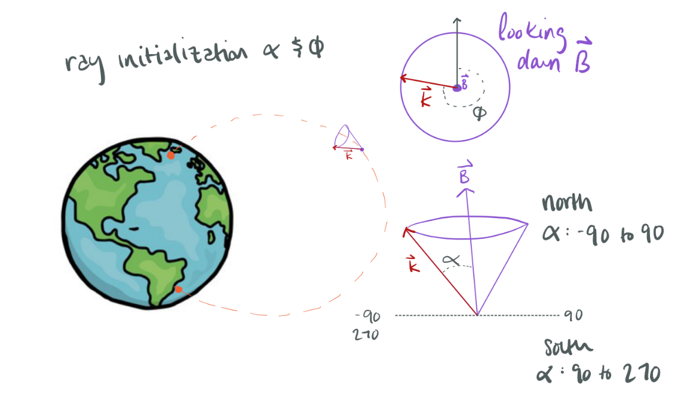

# Raytracer settings 
In this file is a list of all of the settings that go in to the raytracer and a description of each.

For most, I'd reccommend just starting from the default. Note that for ranges with (reccommended), you could technically go outside that range.

## User settings 
- *rayfile_directory*: "/projects/<username>"
  - This is where you want the output of the raytracer to go. I'd stick with your projects directory on the supercomputer. 

## Environment settings
- *date_time_iso_utc*: "2019-04-21T12:00:0.0Z"
  - This is the date and time the rays will be traced at. It needs to be filled out as a string in iso_utc format.
  - Unit = iso utc
  - Range = 1900.0-2020.0 (main field) and 2020.0-2025.0 (secular variation)
  - More info [here](https://en.wikipedia.org/wiki/ISO_8601)

- *minalt*: 500e3
  - This is the minumum altitude above the Earth's surface that the raytracer will trace to. The radius of the Earth is a assumed a constant 6371.2e3 meters. This is one of the 6 ways for the raytracer to stop tracing a ray (see list at end).
  - Unit = meters
  - Range = 0 to 1000e3 (reccommended)

- *mode*: "DE"
  - Plasmasphere model to run in. Modes that are working right now: Diffusive Eqiulbrium ("DE") and simplified GCPM ("GCPM"). DE seems to work a little better, or atleast the results are more explainable. 
  - Diffusive Eqiulbrium is described by this paper: 
    - Angerami, J., & Thomas, J. (1964). Studies of planetary atmospheres: 1. the distribution of electrons and ions in the Earth’s exosphere Journal of Geophysical Research, 69 (21), 4537–4560.
  - GCPM by this paper: 
    - Gallagher, D. L., Craven, P. D., & Comfort, R. H.(2000). Global core plasma model. Journal of Geophysical Research: Space Physics, 105 (A8), 18819–18833.
    - The simplified version of GCPM that is implemented is described in Austin Sousa's thesis: 
      - Sousa, A. P. (2018). Global and seasonal effects of lightning-induced electron precipitation. Stanford University.
  - Unit = string
  - Range = "DE" or "GCPM"

- *Kp*: 1
  - This is the geomagnetic activity index, and will determine where the plasmapause is.
  - Unit = unitless
  - Range = 1 (quiet) to 9 (stormy)
  - More info [here](https://www.swpc.noaa.gov/products/planetary-k-index)

- *Ae*: 1.6 
  - This is the auroral electrojet index.
  - Unit = unitless
  - Range =
  - More info [here](https://www.ngdc.noaa.gov/stp/geomag/ae.html)

- *Pdyn*: 4
  - Solar wind dynamic pressure. Used for the tsyganenko solar wind parameters. 
  - Unit = nanoPascals (nPa)
  - Range = 0.5 to 10 nPa
  - More info [here](https://ccmc.gsfc.nasa.gov/models/modelinfo.php?model=Tsyganenko%20Magnetic%20Field)

- *Dst*: 1.0
  - Distrubance-storm-time index. Used for the tsyganenko solar wind parameters.
  - Unit = nanoTesla (nT)
  - Range = -100 to +20 nT
  - More info [here](https://ccmc.gsfc.nasa.gov/models/modelinfo.php?model=Tsyganenko%20Magnetic%20Field)

- *ByIMF*: 0.0
  - Interplanetary magnetic field in y direction. Used for the tsyganenko solar wind parameters.
  - Unit = nanoTesla (nT)
  - Range = -10 to +10 nT
  - More info [here](https://ccmc.gsfc.nasa.gov/models/modelinfo.php?model=Tsyganenko%20Magnetic%20Field)

- *BzIMF*: -5
  - Interplanetary magnetic field in z direction. Used for the tsyganenko solar wind parameters.
  - Unit = nanoTesla (nT)
  - Range = -10 to +10 nT
  - More info [here](https://ccmc.gsfc.nasa.gov/models/modelinfo.php?model=Tsyganenko%20Magnetic%20Field)

- *W*: [0.132, 0.303, 0.083, 0.070, 0.211, 0.308]
  - Coefficients used by the tsyganenko model. 
  - Unit = unknown
  - Range =unknown

- *use_tsyg*: 1
  - 1 to use the tsyganenko model, 0 to not use it. It doens't have much affect for low Lshell (below 3-4) raytracing and I usually just keep it on.
  - Unit = unitless
  - Range =0 or 1

- *use_IGRF*: 1
  - 1 to use IGRF magnetic field, 0 to use simple dipole model. Currently (09-2021) IGRF-13 is in use.
  - Unit = unitless
  - Range =0 or 1
  - More info [here](https://www.ngdc.noaa.gov/IAGA/vmod/igrf.html)

## Simulation settings
- *t_max*: 10
  - Maximum time for a ray to propagate in the magnetosphere. This is one of the 6 ways for the raytracer to stop tracing a ray (see list at end). This is not related to simulation time, this is the actual time the ray is propagating. 10 seconds is usally plenty, but if you want a lot of reflections or you think the ray might encounter some really intense gradients, consider increasing this. 
  - Unit = seconds
  - Range =0 to 30 (reccommended)

- *dt0*: 1e-3
  - Ray tracer uses adaptive time stepping. This is the initial time step. If you want to use fixedsteps, you can set fixedstep to 1. This timestep will then be the timestep used throughout the ray's path.
  - Unit = seconds
  - Range =1e-4 to 1e-2 (reccommended)
  - More info [here](https://en.wikipedia.org/wiki/Adaptive_step_size)

- *dtmax*: 0.1
  - Maximum allowable time step. Anything larger might have some pretty big errors, and if you want to increase accuracy or number of steps, try decreasing this. 
  - Unit = seconds
  - Range =1e-2 to 0.5 (reccommended)

- *root*: 2
  - This is the root of the appleton hartree equation. 
  - Unit = unitless
  - Range =1 (proton whistler) or 2 (electron whistler)
  - More info [here](https://en.wikipedia.org/wiki/Appleton%E2%80%93Hartree_equation)

- *fixedstep*: 0
  - Use fixed steps (1) or adaptive timesteps (0). Fixed steps have NO way to recover if you pop outside the resonance cone, so adaptive is always recommended.
  - Unit = unitless
  - Range =0 or 1

- *maxerr*: 5.0e-3
  - Error bound for adaptive timestepping. If the error gets to this value (often near resonance cone) the timestep will refine down.
  - Unit = 
  - Range =1e-4 to 1e-2 (reccommended)

- *maxsteps*: 5e3
  - Maximum number of time steps. This is one of the 6 ways for the raytracer to stop tracing a ray (see list at end). Try increasing if your rays are hitting this wall. 
  - Unit = steps
  - Range =1e3 to 10e3 (reccommended)

- *outputper*: 1
  - Output only every “outputper” timesteps (reduces output file size). If file size is a concern, or if you don't care as much about the ray path, change this to 10 or something like that (for context, most rays take several thousand steps).
  - Unit = steps/output
  - Range =1 to 1000 (recommended)

## Ray settings 
Each ray is added with the following input parameters: 

- *alt*: 1000e3 
  - Start altitude from Earth’s surface. The radius of the Earth is a assumed a constant 6371.2e3 meters.
  - Unit = meters
  - Range =300e3 to 5000e3 (reccommended)

- *lat*: 50
  - Start latitude in geographic coordinates (NOT GEOMAGNETIC)
  - Unit = degrees
  - Range = -90 to 90

- *lon*: 0
  - Start longitude in geographic coordinates (NOT GEOMAGNETIC)
  - Unit = degrees
  - Range = -360 to 360

- *freq*: 5e3
  - Frequency of the ray.
  - Unit = hertz
  - Range = 1 to 50e3 (reccommended)

- *alpha*: 180 
  - Wavenormal angle of the ray (angle between k and B)
  - Unit = degrees
  - Range = -90 to 90 (if going towards the northern hemisphere) or 90 to 270 (if going towrds the southern hemisphere)

- *phi*: 0
  - Azimuthal angle on surface of cone created by wavenormal angle
  - Unit = degrees
  - Range = 0 to 360

The Bfield points from south geographic pole to north geographic pole. So if you're starting a ray in the northern hemisphere and you want it to go south with a wavenormal of 10 degrees, set alpha = 190 and phi = 0. The diagram below helps visualize these two angles. You can think if these two angles in two steps: alpha creates a right cone around the magnetic field line with the opening angle equal to alpha. Phi is then the azimuthal angle around the magnetic field line. Gernally, I leave phi = 0 so that the wavenormal angle is in plane with the Bfield. There is a commneted-out section of code in the helper functions script that allos you to plot your direction vector with respect to Bfield, if you want to check. 

field-aligned (going north): alpha = 0, phi = 0
field-aligned (going south): alpha = 180, phi = 0

 

## Stop condition list.
The raytracer will stop if: 

0. max time hit (t_max). Again, not simulation time, but ray time.
1. min altitude reached (minalt)
2. k=0. nonsensical k vector. this is not phyiscal.
3. nonsensical group velocity - faster than speed of light. sometimes happens outside the plasmapause.
---- there is no #4 -----------
5. dt too small (less than 1e-14 seconds). Try adjusting maxerr (lower) and dt0 (lower), or use fixed steps. 
6. maxsteps hit (maxsteps)